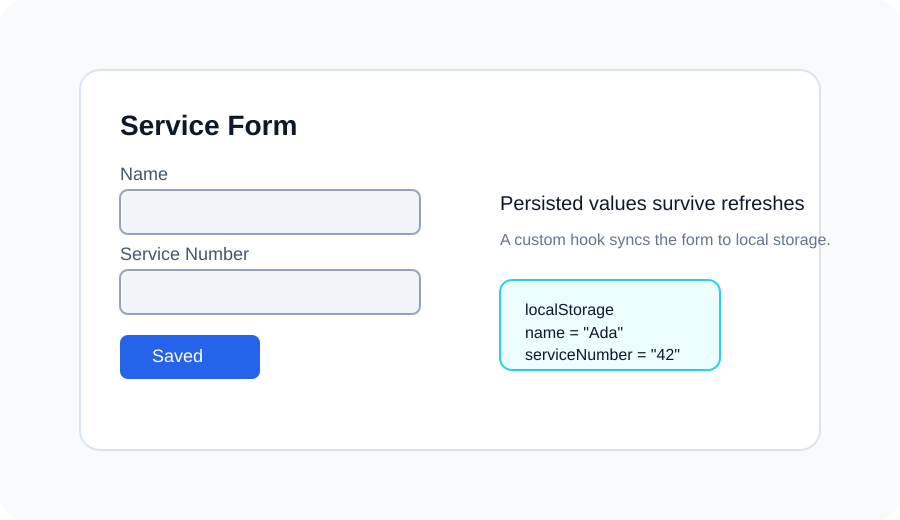

# Form Storage Lab

## Overview
This project demonstrates how a React form can persist user input across page refreshes by pairing a custom hook with the browser’s local storage. The form stores the visitor’s name and service number, then restores those values the next time the page loads.

## What Changed
- Implemented a reusable custom hook that reads from and writes to local storage.
- Connected the form fields to the hook so values persist between refreshes.
- Added inline comments to make the logic clearer for future maintainers.

## Screenshot


## How to Run
```sh
npm install
npm run dev
```

## How to Test
```sh
npm run test
```

## Notes
The hook uses the input key to read the last saved value from local storage on first render, then keeps the stored value in sync whenever the form input changes.

## Resources
- React custom hooks: https://react.dev/learn/reusing-logic-with-custom-hooks
- localStorage API: https://developer.mozilla.org/en-US/docs/Web/API/Window/localStorage